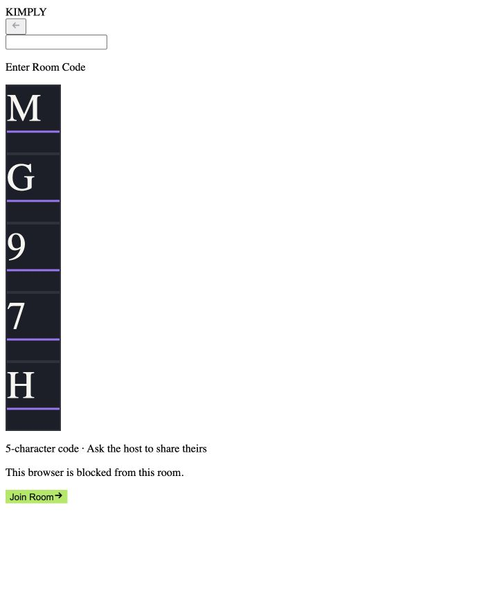
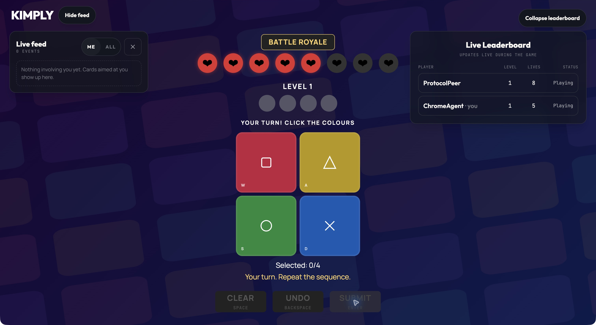

# Bot-detection verification - 2026-10-12

Tested worktree `.claude/worktrees/142-bot-detection`, branch `142-bot-detector`, commit `58d3b76`.
The main checkout and the lobby worktree were not changed.
No application source, Terraform, deployment, commit, or push was performed.

## Result

**Not ready to sign off: two failures remain.**
The timing detector and session block work, but spoofed forwarded headers bypass the IP ban.
The local production-mode browser also loses its main stylesheet.

## Checks completed

| Check                                                                | Result            | Evidence                                                                                                         |
| -------------------------------------------------------------------- | ----------------- | ---------------------------------------------------------------------------------------------------------------- |
| `meteor npm test`                                                    | Pass              | 200 server tests, exit 0                                                                                         |
| `meteor test --once --full-app --driver-package meteortesting:mocha` | Pass              | 200 app-server tests, exit 0                                                                                     |
| `meteor npm run format:check`                                        | Pass              | All matched files use Prettier style                                                                             |
| First two fast attempts, then third-attempt removal                  | Pass              | Real DDP; third call returns `removed-automation`                                                                |
| Session block survives a new connection                              | Pass              | Resuming the removed session returns `banned`, reason `session`                                                  |
| Existing shared-IP player can still submit                           | Pass              | Peer completes a normal attempt after bot removal                                                                |
| Fresh session and rebind blocked by normal IP ban                    | Pass              | Nginx room `3LD8M`; both return `banned`, reason `address`                                                       |
| Other-room create/join remains available                             | Pass              | Same client address creates and joins another room                                                               |
| Different client address can join                                    | Pass              | Separate Docker network client joins disposable lobby `3LD8M` during its IP ban                                  |
| Ban duration                                                         | Pass              | Stored `expiresAt - createdAt` is exactly 900000 ms                                                              |
| Ban expiry enforcement                                               | Pass with fixture | Moving the disposable ban timestamp into the past permits a fresh same-address session to join                   |
| Private guard and room security fields excluded                      | Pass              | Inspected live DDP player and lobby publications                                                                 |
| Removal permits immediate round advancement                          | Pass              | Remaining two players finish and advance without disconnect grace                                                |
| Round-two draft gate                                                 | Pass through DDP  | `draft-open` before choosing; a normal submission grades after both skips in room `J5R59`                        |
| Mouse and keyboard grading                                           | Pass in browser   | Normal wrong answers deduct one life and show the result                                                         |
| Undo and clear followed by submit                                    | Pass in browser   | Keyboard attempt grades without stale/duplicate-attempt errors                                                   |
| Refresh mid-round                                                    | Pass in browser   | Remaining lives are retained; subsequent keyboard grading works                                                  |
| Removal screen, Back to play, same-browser rejoin                    | Pass with fixture | Detector-equivalent removal state shows RemovedScreen; Back to play navigates; rejoin displays the browser block |
| Spoofed `X-Forwarded-For` IP enforcement                             | **Fail**          | Rooms `B2YDT`, `39MCM`, and proxied `JCSZW` contain a session block but no IP ban                                |
| Production-mode stylesheet                                           | **Fail**          | `/build-chunks/main.b70987423f38e5ae.css` returns HTTP 500; server logs ENOENT                                   |

The browser removal-state fixture was applied directly to disposable data after the detector was independently verified through real DDP.
It is not a claim that three suspicious attempts were reproduced entirely through browser keyboard automation.
The eight-life Battle Royale fixture avoids standard-round timeouts during removal-screen inspection.
The heart track deliberately includes grey empty slots; its total number of heart symbols is not evidence of restored lives.

## D44 - Spoofed-header IP-ban bypass

The raw bot sends `X-Forwarded-For: 198.51.100.20` while Nginx appends the real peer address.
Meteor returns no `clientAddress` when the forwarded-header length does not match its configured proxy count.
`addressOf` returns null and `removeDetectedPlayer` writes only `security.blockedSessionIds`, logging `missing client address`.
After setting the disposable room back to lobby, a fresh session on the same real address joins `JCSZW` successfully.
The control room `3LD8M`, without the spoofed header, stores the real address, refuses that fresh session, and allows a different address.
The spoofed address is not trusted, but dropping the IP ban still bypasses the intended protection.

The local proxy test used two counted hops: Nginx and the internal `meteor run` proxy.
The direct local test configured `HTTP_FORWARDED_COUNT=0`; Meteor adds its internal development hop for the application process.
No ALB or deployed production environment was tested.

Reproduce with the existing `app/tests/manual/ddpBot.mjs`, a custom room with at least four colours and enough lives, and `--xff 198.51.100.20`.
Inspect the resulting room's `security` field and the `missing client address` server log.
A fix needs a trusted ingress/address policy that cannot turn an attacker-supplied header into a missing-address exemption.
Do not accept a client-supplied address as the replacement.

## D45 - Missing production-mode stylesheet

Running the isolated worktree with `meteor run --production` serves the application but returns HTTP 500 for its main Rspack CSS chunk.
The server attempts to stat `/kimply/app/.meteor/local/build/programs/server/build-chunks/main.b70987423f38e5ae.css`, which does not exist.
The removed-player and join screens consequently render with default browser styling.
This is confirmed for the local production simulation; the deployed image was not assessed.
Fix and verify the emitted CSS asset path and its server registration using a clean production build.



## Agent-driven Chrome gameplay comparison

Follow-up test on 2026-10-12 used a fresh Google Chrome Incognito window with `BOT_DETECTION_ENABLED=true`.
Codex operated the native Chrome UI using ordinary clicks; this was not the Claude Chrome extension.
No detector counters or submission timing evidence were injected.

The initial standard game expired during inspection, so the completed comparison used disposable Battle Royale room `8L4EN` with eight starting lives and fast playback.
Only those room settings were adjusted as a test fixture to allow three wrong attempts without a standard-round deadline.
The agent clicked the four colour tiles and Submit, waited for replay, and repeated this for three attempts.

The server reported:

```json
{
  "gameId": "8L4EN",
  "name": "ChromeAgent",
  "totalGuesses": 3,
  "lives": 5,
  "botStrikes": 0,
  "eliminated": false,
  "connected": true
}
```

The room had no session block or IP ban for this player.
A machine-speed DDP control in room `LUR73`, using the same enabled app, was removed on its third attempt with `removed-automation`.
The control also passed session blocking, IP blocking, shared-IP continuation, private-field exclusion, and immediate round advancement.

**Conclusion:** the timing detector operates, but it does not detect this ordinary point-and-click browser automation.
The result cannot establish how every Claude Chrome session behaves.
It demonstrates that AI-controlled browser input can remain below the detector's suspicion threshold.

A temporary Rspack configuration outside the repository disabled development hot reload for stable testing alongside the other worktrees.
The development UI rendered with styling; this does not resolve D45's separate production-mode CSS failure.
The isolated test app remains available on `http://localhost:3142` for follow-up tests.



## Still unverified

- Client-side Mocha tests were not executed by the server-only runners.
- A full browser submission after replay, and the browser UI during a round-two draft, remain unverified.
- The development-disable toggle has unit coverage but was not exercised in a running development app during this session.
- The 15-minute wall-clock wait was not run; duration and controlled expiry were verified separately.
- ALB behavior and deployed production CSS require their own verification.

The initial development UI repeatedly reloaded because its HMR endpoint conflicted with the other local development server.
A local production-mode run was used for stable browser checks, which exposed D45.
The test plan's old claim that formatting fails does not hold for this worktree.
